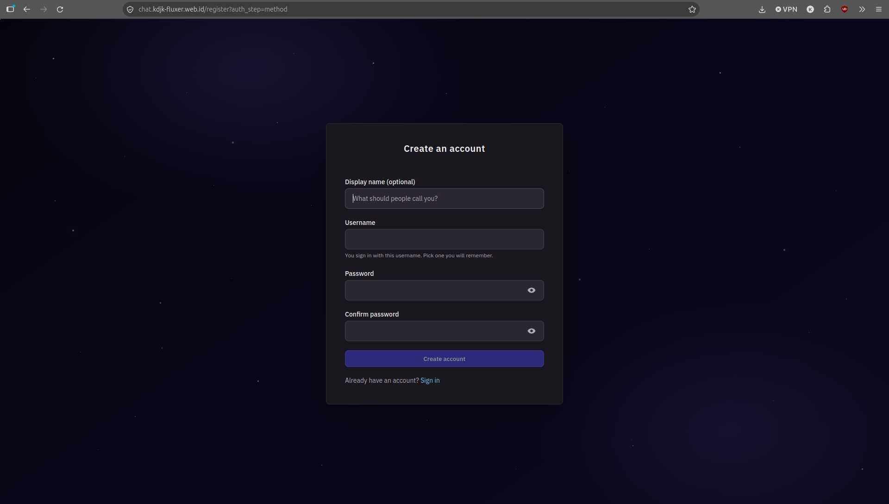
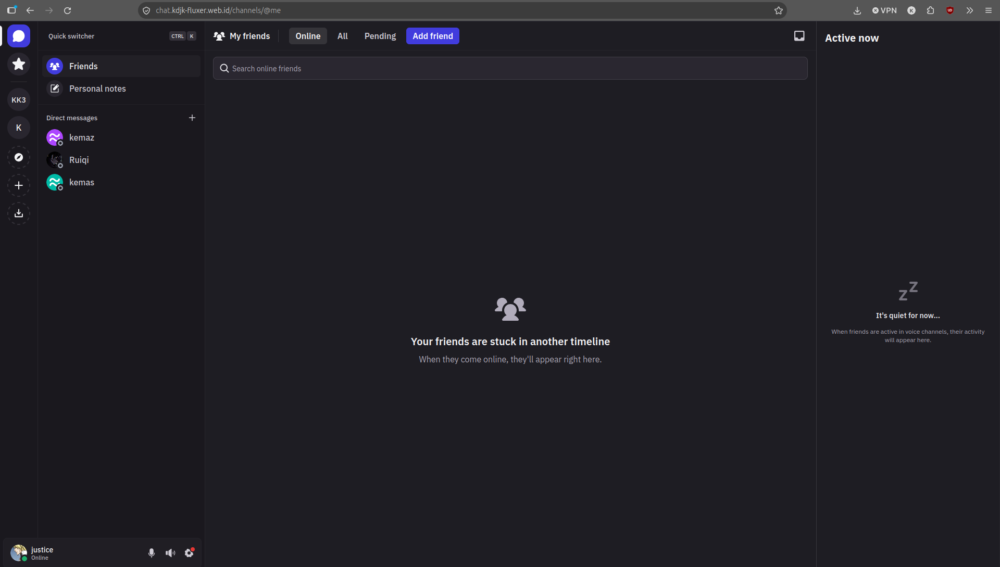
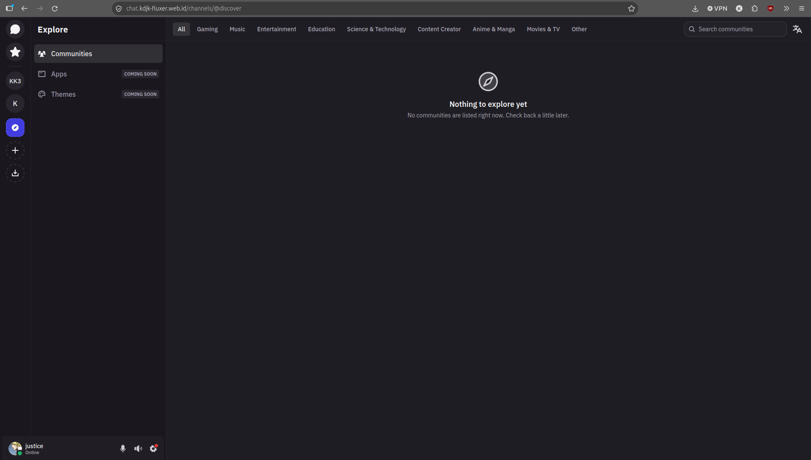
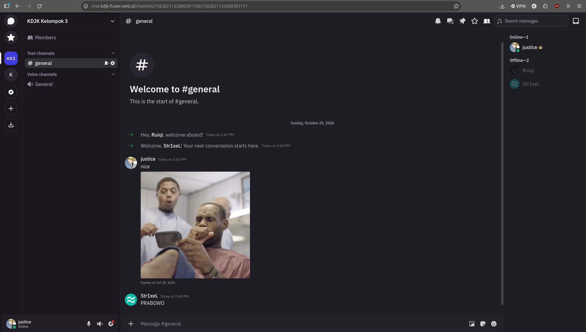
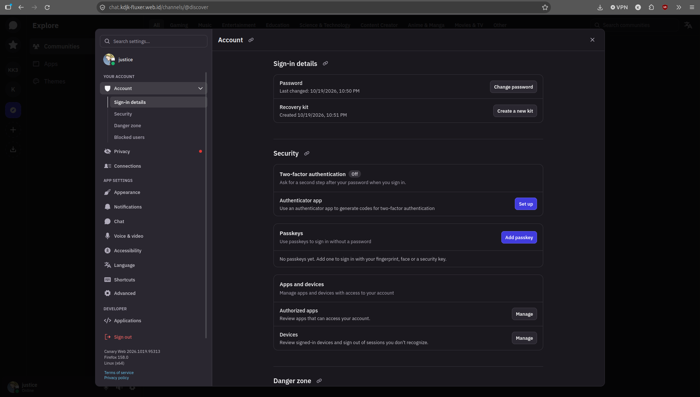

# Fluxer


## Sekilas Tentang

Fluxer adalah aplikasi chat komunitas open source (lisensi AGPLv3) yang dapat di-hosting sendiri, dirancang sebagai alternatif Discord. Fitur utamanya meliputi server komunitas, kanal teks, pesan langsung, upload berkas, pencarian pesan, serta suara/video.

Pengaturan self-hosting resminya berjalan di atas Docker Compose dengan banyak layanan (sekitar 25 container menurut salah satu sumber), antara lain PostgreSQL, Valkey, NATS, Meilisearch, SeaweedFS, LiveKit, API, gateway, worker, dan Caddy sebagai proxy.

**Lingkungan**

| Komponen | Nilai |
|---|---|
| Server | VM VirtualBox (host Linux Mint), Ubuntu Server 24.04 LTS, jaringan NAT |
| Spesifikasi | 4 vCPU, 8 GB RAM, 80 GB disk |
| Akses publik | Cloudflare Tunnel (HTTPS dikelola Cloudflare) |
| Domain | `chat.kdjk-fluxer.web.id` (domain dibeli di Dewabiz, DNS dikelola Cloudflare) |
| Image | `ghcr.io/fluxerapp/fluxer-api:v1` |


## Instalasi

Prasyarat:
- Server Ubuntu Server 24.04 LTS (VPS atau VM) dengan RAM minimal 8 GB (lebih besar lebih aman).
- Domain/subdomain. Jalur VPS dengan IP publik: A record mengarah ke IP VPS, port 80 dan 443 terbuka. Jalur Cloudflare Tunnel: lihat bagian "Akses Publik via Cloudflare Tunnel".
- Docker Engine dan plugin Docker Compose (ikuti panduan resmi: https://docs.docker.com/engine/install/ubuntu/).

Verifikasi Docker:

```
sudo systemctl enable --now docker
docker --version
docker compose version
sudo docker run --rm hello-world
```

Unduh berkas deployment resmi:

```
sudo mkdir -p /opt/fluxer
sudo chown "$USER":"$(id -gn)" /opt/fluxer
cd /opt/fluxer

BASE="https://raw.githubusercontent.com/fluxerapp/fluxer/main/deploy/self-hosting"
curl -fLO "$BASE/docker-compose.yml"
curl -fLO "$BASE/Caddyfile"
curl -fsSL "$BASE/.env.example" -o .env
chmod 600 .env
```

Atur domain di `.env` sesuai jalur akses. Untuk VPS dengan IP publik, ikuti komentar bawaan `.env` (Caddy mengurus HTTPS sendiri lewat port 80/443). Untuk VM tanpa IP publik, gunakan Cloudflare Tunnel (bagian berikut), yang nilai `.env`-nya berbeda.

Ganti semua nilai `CHANGE_ME` dengan secret acak:

```
grep -n 'CHANGE_ME' .env
openssl rand -hex 32     # ulangi untuk tiap variabel, lalu isi ke .env
```

Pada percobaan ini tersisa tiga: `POSTGRES_PASSWORD`, `MEILI_MASTER_KEY`, dan `LIVEKIT_API_SECRET`.

Buat setup token agar instance baru dapat didaftarkan:

```
TOKEN=$(openssl rand -hex 32)
sed -i '/^#FLUXER_SETUP_TOKEN=/d; /^FLUXER_SETUP_TOKEN=/d' .env
printf '\nFLUXER_SETUP_TOKEN=%s\n' "$TOKEN" >> .env
```

Validasi dan jalankan:

```
sudo docker compose config --quiet
sudo docker compose pull
sudo docker compose up -d
sudo docker compose ps
```

Kemudian kunjungi `https://<domain-anda>`, masukkan setup token, dan buat akun.

> Jangan unggah `.env` ke GitHub. Tambahkan `.env` ke `.gitignore`.

### Akses Publik via Cloudflare Tunnel

VM berada di belakang NAT tanpa IP publik, sehingga akses dari internet dibuat lewat Cloudflare Tunnel: `cloudflared` di dalam VM membuat koneksi keluar ke Cloudflare, dan Cloudflare meneruskan permintaan ke Caddy lokal serta menyediakan HTTPS. Tidak ada port router atau port forwarding VirtualBox yang perlu dibuka untuk jalur ini.

Prasyarat: akun Cloudflare (gratis), domain yang nameserver-nya diarahkan ke Cloudflare, dan `cloudflared` terpasang di VM (ikuti panduan resmi Cloudflare untuk Ubuntu).

**1. Tambahkan domain ke Cloudflare.** Di dashboard Cloudflare pilih *Add a site* dengan paket Free, lalu ganti nameserver domain di panel registrar (Dewabiz) ke dua nameserver yang diberikan. Tunggu status situs menjadi *Active*.

**2. Buat tunnel dan rute DNS.**

```
cloudflared tunnel login
cloudflared tunnel create fluxer
cloudflared tunnel route dns fluxer chat.kdjk-fluxer.web.id
```

Jika `route dns` gagal dengan error 1003 (record sudah ada), hapus record `chat` yang lama di *DNS → Records* pada dashboard Cloudflare, lalu ulangi.

**3. Buat `~/.cloudflared/config.yml`** (ganti `<ID-TUNNEL>` dengan ID dari langkah 2; berkas `.json` kredensial bersifat rahasia):

```yaml
tunnel: <ID-TUNNEL>
credentials-file: /home/fluxer/.cloudflared/<ID-TUNNEL>.json
ingress:
  - hostname: chat.kdjk-fluxer.web.id
    service: http://localhost:19080
  - service: http_status:404
```

**4. Sesuaikan `.env` Fluxer.** Alamat publik yang dilihat browser dibuat HTTPS, sedangkan Caddy tetap melayani HTTP biasa di port 19080 (variabel `FLUXER_HTTP_PORT` dan `FLUXER_HTTPS_PORT` tidak diubah):

```
FLUXER_DOMAIN=chat.kdjk-fluxer.web.id
FLUXER_PUBLIC_SCHEME=https
FLUXER_PUBLIC_PORT=443
FLUXER_PUBLIC_ORIGIN=https://chat.kdjk-fluxer.web.id
FLUXER_EDGE_SITE_ADDRESS=http://chat.kdjk-fluxer.web.id
FLUXER_HTTP_PORT=19080
FLUXER_HTTPS_PORT=127.0.0.1:443
```

**5. Terapkan dan jalankan tunnel.**

```
cd /opt/fluxer
sudo docker compose config --quiet
sudo docker compose up -d
sudo docker compose ps
cloudflared tunnel run fluxer      # biarkan berjalan (mis. di tmux)
```

**6. Verifikasi.**

```
curl -s -H 'Host: chat.kdjk-fluxer.web.id' http://127.0.0.1:19080/_health   # OK (langsung ke Caddy)
curl -s https://chat.kdjk-fluxer.web.id/_health                              # OK (lewat tunnel)
```

Lalu buka `https://chat.kdjk-fluxer.web.id` dari perangkat di jaringan lain (mis. HP dengan data seluler).

## Konfigurasi (opsional)

Batas memori bawaan Fluxer ditujukan untuk host 16 GB. Pada RAM 8 GB, nilai berikut dipakai sebagai titik awal (tambahkan di bagian bawah `.env`, lalu pantau dengan `docker stats --no-stream`):

```
FLUXER_POSTGRES_MEMORY_LIMIT=1gb
FLUXER_MEILISEARCH_MEMORY_LIMIT=768mb
FLUXER_MEILISEARCH_MAX_INDEXING_MEMORY=128mb
FLUXER_MEILISEARCH_MAX_INDEXING_THREADS=1
FLUXER_SEAWEEDFS_MEMORY_LIMIT=768mb
FLUXER_API_MEMORY_LIMIT=1280mb
FLUXER_API_NODE_HEAP_MB=768
FLUXER_WORKER_MEMORY_LIMIT=1280mb
FLUXER_WORKER_NODE_HEAP_MB=768
FLUXER_GATEWAY_MEMORY_LIMIT=512mb
FLUXER_LIVEKIT_MEMORY_LIMIT=384mb
```

Daftar variabel lengkap ada di `.env.example`. Nilai ini eksperimen, bukan konfigurasi resmi yang dijamin stabil.


## Pemeliharaan (Maintenance)

Stack Fluxer terdiri dari banyak container, jadi pemeliharaan rutin dibagi menjadi: memeriksa kesehatan, mem-backup data, memperbarui versi, dan menjaga disk. Semua perintah dijalankan dari `/opt/fluxer`. Bagian Otomatisasi setelah ini menjalankan sebagian besar pekerjaan ini secara terjadwal.

### Pemeriksaan Rutin

| Seberapa sering | Yang diperiksa | Perintah |
| --- | --- | --- |
| **Harian** | Semua container *healthy*, tidak ada yang restart terus-menerus | `sudo docker compose ps` |
| **Harian** | Error terbaru pada API dan gateway | `sudo docker compose logs --since 24h --tail 100 api gateway` |
| **Mingguan** | Pemakaian RAM dan CPU per container (acuan batas memori pada bagian Konfigurasi) | `sudo docker stats --no-stream` |
| **Mingguan** | Sisa disk VM dan ukuran Docker | `df -h /` dan `sudo docker system df` |
| **Mingguan** | Backup terakhir ada dan ukurannya wajar | `ls -lh /var/backups/fluxer` |
| **Bulanan** | Uji pulihkan backup di VM lain (lihat Restore) | - |
| **Bulanan** | Pembaruan keamanan Ubuntu | `sudo apt update && sudo apt upgrade` |

---

### Backup

Yang perlu disimpan dan yang tidak:

| Data | Lokasi | Dibackup? | Alasan |
| --- | --- | --- | --- |
| **Database** (akun, server, kanal, pesan) | volume `postgres-data` | **Ya**, lewat `pg_dump` | Data utama |
| **Lampiran dan upload** | volume `seaweedfs-data` | **Ya**, salin volume | Tidak ada di database |
| **`.env`, `Caddyfile`, `docker-compose.yml`** | `/opt/fluxer` | **Ya** | Berisi secret dan pengaturan domain |
| **Kredensial Cloudflare Tunnel** | `~/.cloudflared` | **Ya** | Tanpa ini tunnel harus dibuat ulang |
| **Indeks pencarian** | volume `meilisearch-data` | Opsional (`INCLUDE_MEILI=1`) | Turunan dari data lain; belum kami uji apakah dibangun ulang otomatis |
| **Cache dan antrean** | volume `valkey-data`, `nats-data` | Tidak | Data sementara (asumsi, belum diuji) |

**Backup manual** (skrip dari bagian Otomatisasi), hasilnya di `/var/backups/fluxer/<tanggal-jam>/`:
```bash
sudo /opt/fluxer/scripts/backup.sh
```

*Isi folder backup:* `postgres.dump`, `seaweedfs-data.tgz`, `config.tgz`, `cloudflared.tgz` (jika ada), dan `SHA256SUMS`.

Simpan salinan di luar VM. Backup di disk yang sama ikut hilang jika VM rusak. Salin ke komputer host atau penyimpanan lain (lihat `POST_BACKUP_CMD` di `maintenance.conf.example`). File backup berisi secret dari `.env`, jadi jangan diunggah ke GitHub.

*Catatan:* database di-dump saat berjalan (aman), sedangkan volume SeaweedFS disalin saat berjalan sehingga bisa terlewat lampiran yang diunggah tepat saat penyalinan. Untuk salinan yang pasti konsisten, set `STOP_SEAWEEDFS=1` (upload terhenti beberapa detik).

---

### Restore (Memulihkan Data)

Lakukan di VM yang sama atau VM baru dengan instalasi Fluxer yang sudah terpasang. Ganti `<FOLDER>` dengan folder backup, mis. `/var/backups/fluxer/20261026-023000`.

```bash
cd /opt/fluxer
(cd <FOLDER> && sha256sum -c SHA256SUMS)          # pastikan berkas utuh
sudo docker compose down                           # volume tidak terhapus
sudo docker compose up -d postgres

# 1. Database
sudo docker compose exec -T postgres sh -c 'dropdb -U "$POSTGRES_USER" --if-exists "$POSTGRES_DB" && createdb -U "$POSTGRES_USER" "$POSTGRES_DB"'
sudo docker compose exec -T postgres sh -c 'pg_restore -U "$POSTGRES_USER" -d "$POSTGRES_DB" --no-owner' < <FOLDER>/postgres.dump

# 2. Lampiran (SeaweedFS)
sudo docker run --rm -v fluxer_seaweedfs-data:/data -v <FOLDER>:/backup alpine:3 \
  sh -c 'find /data -mindepth 1 -delete && tar xzf /backup/seaweedfs-data.tgz -C /data'

# 3. Jalankan kembali dan verifikasi
sudo docker compose up -d
sudo /opt/fluxer/scripts/healthcheck.sh
```

Pada VM baru, pulihkan juga `config.tgz` ke `/opt/fluxer` (berisi `.env` lama, termasuk semua secret) sebelum menjalankan stack, dan `cloudflared.tgz` ke `/home/fluxer`. Jika `.env` berbeda dari yang dipakai saat backup, akun dan sesi lama bisa tidak valid.

---

### Pembaruan Versi

Image memakai tag `v1` yang bergerak (`FLUXER_IMAGE_TAG=v1`), jadi `docker compose pull` bisa membawa versi baru kapan saja. Karena itu pembaruan dijalankan manual dan terencana, bukan otomatis:

```bash
sudo /opt/fluxer/scripts/update.sh
```

Skrip ini melakukan: backup, mencatat versi image yang sedang dipakai (`/var/backups/fluxer/digests-before-update-*.txt`), pull, `up -d`, menunggu health check lolos, lalu membersihkan image lama. Jika gagal, notifikasi terkirim (bila webhook diatur) dan pesan error muncul di terminal.

**Rollback:** `FLUXER_IMAGE_TAG` berlaku untuk semua image sekaligus, sehingga satu digest tidak bisa dipakai untuk semuanya. Cara yang realistis: jika upstream menyediakan tag versi spesifik (mis. `v1.2.3`), isi `FLUXER_IMAGE_TAG` di `.env` dengan tag lama lalu `sudo docker compose up -d`. Berkas `digests-before-update-*.txt` mencatat versi persis yang berjalan sebelumnya sebagai bukti dan acuan. Jika versi baru sudah mengubah skema database dan data bermasalah, pulihkan database dari backup yang dibuat tepat sebelum update. Prosedur rollback ini belum diuji pada instalasi kami.

Sebelum update, baca catatan rilis di [GitHub Fluxer](https://github.com/fluxerapp/fluxer). Pembaruan sistem operasi (`apt`) dilakukan terpisah; reboot VM setelah pembaruan kernel.

---

### Log dan Disk

Berkas compose tidak mengatur rotasi log, sehingga log setiap container bisa terus membesar di disk 80 GB. Batasi lewat `/etc/docker/daemon.json`:

```json
{
  "log-driver": "json-file",
  "log-opts": { "max-size": "10m", "max-file": "3" }
}
```

```bash
sudo systemctl restart docker
cd /opt/fluxer && sudo docker compose up -d --force-recreate   # pengaturan baru hanya berlaku untuk container baru
```

**Bersih-bersih aman** (tidak menyentuh volume data):
```bash
sudo docker image prune -f           # image yang tidak terpakai
sudo journalctl --vacuum-time=14d    # log sistem lama
```

> ⚠️ **Peringatan:** Hindari `docker compose down -v`, `docker volume prune`, dan `docker system prune --volumes`. Ketiganya menghapus volume, yaitu seluruh data Fluxer.

---

### Masalah Umum

| Gejala | Kemungkinan Penyebab | Tindakan |
| --- | --- | --- |
| **Halaman daftar menampilkan "Verification required"** | Setup token belum diisi (`SETUP_TOKEN_REQUIRED`) | Pastikan `FLUXER_SETUP_TOKEN` ada di `.env`, lalu `sudo docker compose up -d` |
| **Situs tidak terbuka dari internet, tetapi `curl http://127.0.0.1:19080/_health` menjawab OK** | `cloudflared` mati | `sudo systemctl status cloudflared-fluxer`, lihat log dengan `journalctl -u cloudflared-fluxer -n 50` |
| **`route dns` gagal dengan error 1003** | Record DNS lama masih ada | Hapus record lama di dashboard Cloudflare, ulangi |
| **Container sering restart atau VM lambat** | Memori kurang | `sudo docker stats --no-stream`, turunkan batas memori (bagian Konfigurasi) |
| **Disk penuh** | Log, image, atau backup lokal menumpuk | `docker system df`, atur rotasi log, kecilkan `RETENTION_DAYS` |
| **Setelah reboot VM, situs tidak naik** | Docker tidak aktif saat boot | `sudo systemctl enable --now docker`, container memakai `restart: unless-stopped` dan naik sendiri |
| **Reboot komputer host, VM mati** | VM VirtualBox tidak start otomatis | Jalankan VM kembali, atau atur autostart VirtualBox di host |

---

## Otomatisasi

Pekerjaan berulang dijadwalkan dengan `systemd timer` di VM (dipilih dibanding cron karena log tersimpan di `journalctl`, dan pekerjaan yang terlewat karena VM mati dijalankan saat VM hidup kembali). Skripnya ada di repositori ini dan sudah diperiksa sintaksnya dengan `bash -n` serta diuji dengan docker tiruan, tetapi belum dijalankan pada instalasi Fluxer nyata. Jalankan checklist verifikasi di bawah setelah memasang.

| Komponen | Berkas | Fungsi | Jadwal |
| --- | --- | --- | --- |
| **Backup** | `deploy/scripts/backup.sh`, `fluxer-backup.timer` | Dump database, salin upload dan konfigurasi, checksum, hapus backup lebih dari 7 hari | Setiap hari 02:30 |
| **Health check** | `deploy/scripts/healthcheck.sh`, `fluxer-healthcheck.timer` | Cek container, Caddy lokal, alamat publik, disk, memori, umur backup; notifikasi saat status berubah | Setiap 5 menit |
| **Tunnel** | `cloudflared-fluxer.service` | Menjalankan Cloudflare Tunnel sebagai layanan (pengganti tmux), start saat boot dan restart jika mati | Terus berjalan |
| **Update** | `deploy/scripts/update.sh` | Update terkontrol dengan backup di awal | Manual |
| **CI** | `.github/workflows/validate.yml` | Validasi compose, ShellCheck, cek secret tidak ter-commit | Setiap push, PR, dan mingguan |

---

### Memasang

Dari VM, di dalam salinan repositori ini (`git clone <URL-REPOSITORI-KELOMPOK>`):

```bash
# Zona waktu agar jadwal sesuai WIB
sudo timedatectl set-timezone Asia/Jakarta

# Skrip
sudo install -d -m 755 /opt/fluxer/scripts
sudo install -m 755 deploy/scripts/*.sh /opt/fluxer/scripts/
sudo install -m 600 deploy/scripts/maintenance.conf.example /opt/fluxer/scripts/maintenance.conf

# Unit systemd
sudo install -m 644 deploy/systemd/*.service deploy/systemd/*.timer /etc/systemd/system/
sudo systemctl daemon-reload
```

Periksa dua hal sebelum mengaktifkan: lokasi `cloudflared` (`command -v cloudflared`, harus sama dengan `ExecStart` di `cloudflared-fluxer.service`) dan nama pengguna `fluxer` pada berkas yang sama (sesuaikan jika berbeda). Hentikan dulu `cloudflared tunnel run fluxer` yang berjalan di tmux, lalu:

```bash
sudo systemctl enable --now cloudflared-fluxer.service
sudo systemctl enable --now fluxer-backup.timer fluxer-healthcheck.timer
systemctl list-timers 'fluxer-*'
```

---

### Pengaturan

Semua opsi ada di `/opt/fluxer/scripts/maintenance.conf` (contoh dan penjelasan: `deploy/scripts/maintenance.conf.example`). Yang paling berguna:

| Opsi | Bawaan | Keterangan |
| --- | --- | --- |
| `RETENTION_DAYS` | `7` | Lama backup lokal disimpan |
| `WEBHOOK_URL` | *kosong* | URL webhook Discord atau Slack untuk notifikasi. Format payload mengikuti keduanya, tetapi belum kami uji |
| `POST_BACKUP_CMD` | *kosong* | Perintah setelah backup, mis. `rsync` ke komputer host |
| `INCLUDE_MEILI` | `0` | `1` untuk ikut membackup indeks pencarian |
| `STOP_SEAWEEDFS` | `0` | `1` untuk salinan upload yang pasti konsisten |
| `CHECK_PUBLIC` | `1` | `0` jika instance tidak memakai alamat publik |

**Mengubah jadwal:** `sudo systemctl edit --full fluxer-backup.timer` (ubah `OnCalendar`), lalu `sudo systemctl restart fluxer-backup.timer`.

---

### Verifikasi Otomatisasi

Isi kolom hasil sesuai kenyataan setelah dicoba.

| Pengujian | Cara | Hasil |
| --- | --- | --- |
| **Backup manual berjalan** | `sudo /opt/fluxer/scripts/backup.sh`, lalu cek isi folder dan `sha256sum -c SHA256SUMS` | |
| **Timer terdaftar** | `systemctl list-timers 'fluxer-*'` | |
| **Health check lolos** | `sudo /opt/fluxer/scripts/healthcheck.sh` (harus OK) | |
| **Health check mendeteksi gangguan** | `sudo systemctl stop cloudflared-fluxer`, jalankan health check (harus MASALAH), lalu start kembali | |
| **Notifikasi terkirim** | Isi `WEBHOOK_URL`, ulangi pengujian di atas | |
| **Tunnel naik sendiri setelah reboot** | `sudo reboot`, lalu buka situs dari HP | |
| **Restore berhasil** | Ikuti Restore di VM cadangan, login dengan akun lama | |

*Log pekerjaan terjadwal:*
```bash
journalctl -u fluxer-backup -n 50
journalctl -u fluxer-healthcheck -n 50
```

---

### CI di GitHub

Workflow `.github/workflows/validate.yml` berjalan otomatis di tab Actions dan memeriksa tiga hal:
1. `docker compose config` pada `deploy/self-hosting`
2. ShellCheck untuk semua skrip di `deploy/scripts`
3. Tidak ada `.env`, `maintenance.conf`, file backup, atau kredensial Cloudflare yang ikut ter-*commit*. Berkas `.gitignore` sudah menyertakan pola-pola tersebut.

---

### Yang Sengaja Tidak Diotomatisasi

- **Update versi:** Tag `v1` bergerak dan pembaruan dapat mengubah skema database, jadi update dijalankan manual lewat `update.sh` saat ada yang bisa mengawasi.
- **Restore:** Menimpa data yang berjalan, sehingga harus keputusan manusia.
- **Rotasi secret:** Mengganti nilai di `.env` membuat sesi dan token lama tidak berlaku.

---

## Cara Pemakaian

### Hasil Pengujian Fungsi Utama

| No | Pengujian | Hasil / Dokumentasi |
| --- | --- | --- |
| 1 | **Semua layanan berjalan** |  |
| 2 | **Web dapat dibuka dari internet** |  |
| 3 | **Setup dan pembuatan akun** |  |
| 4 | **Kirim dan terima pesan** |  |
| 5 | **Upload lampiran** |  |

1. Halaman Setup dan Registrasi
   
   Pada instance baru, pengguna menyelesaikan setup dengan setup token lalu mendaftarkan akun pertama.

2. Halaman Utama
   
   Setelah login, pengguna melihat daftar server, kanal, dan pesan langsung.

3. Membuat Komunitas dan Kanal
   
   Dibuat komunitas **KDJK Kelompok 3** dengan kanal `#general`, `#pengumuman`, dan `#dokumentasi`. 

4. Mengirim Pesan dan Lampiran
   
   Beberapa akun demo saling bertukar pesan dan mengunggah lampiran pada kanal.

5. Pengaturan Pengguna
   
   Pengguna dapat mengubah profil dan tampilan.

---

### Detail Alur Penggunaan

1. **Halaman Setup dan Registrasi**  
   Pada instance baru, pengguna menyelesaikan setup awal menggunakan setup token lalu mendaftarkan akun administrator/pertama.
2. **Halaman Utama**  
   Setelah login, pengguna melihat daftar server, kanal teks/suara, dan daftar pesan langsung (*Direct Messages*).
3. **Membuat Komunitas dan Kanal**  
   Dibuat komunitas **KDJK Kelompok 3** dengan kanal `#general`, `#pengumuman`, dan `#dokumentasi`.
4. **Mengirim Pesan dan Lampiran**  
   Beberapa akun demo saling bertukar pesan real-time dan mengunggah lampiran berkas pada kanal.
5. **Pengaturan Pengguna**  
   Pengguna dapat mengubah profil, nama tampilan, kata sandi, dan tema tampilan aplikasi.

---
## Pembahasan

### Kelebihan Fluxer

1. **Open source dan self-hosted**: kode terbuka (AGPLv3) dan data tetap di server sendiri.
2. **Pengalaman mirip Discord**: server, kanal, pesan langsung, upload, dan pencarian sehingga mudah dipakai pengguna baru.
3. **Deployment resmi dikemas dalam Docker Compose**: instalasi dapat diulang dengan beberapa perintah.
4. **ALTCHA bawaan**: perlindungan pendaftaran tanpa layanan CAPTCHA eksternal.

### Kekurangan Fluxer

1. **Berat sumber daya**: banyak layanan sekaligus. Pada RAM 8 GB perlu tuning manual karena batas bawaan ditujukan untuk 16 GB.
2. **Konfigurasi rumit**: banyak secret wajib, routing bergantung hostname, dan perlu setup token.
3. **Pesan error kurang jelas**: "Verification required" muncul padahal penyebab aslinya `SETUP_TOKEN_REQUIRED`.
4. **Masih berkembang**: pengembang menyebut membuat self-hosting andal sebagai prioritas, sehingga kemungkinan masih ada kekurangan.
5. **Butuh HTTPS**: ALTCHA tidak berjalan di HTTP non-localhost, sehingga tidak cocok untuk akses HTTP biasa dari perangkat lain.

### Perbandingan Fluxer dengan Aplikasi Sejenis

#### 1. Fluxer vs Discord

- **Kelebihan Fluxer:**
  * Open source dan dapat di-hosting sendiri, data di server sendiri.
  * Tidak bergantung pada satu penyedia layanan.
- **Kelebihan Discord:**
  * Komunitas dan ekosistem (bot, integrasi) jauh lebih besar.
  * Matang dan stabil, tidak perlu mengelola server sendiri.

#### 2. Fluxer vs Revolt

- **Kelebihan Fluxer:**
  * Berusaha menyamai pengalaman Discord selengkap mungkin. 
- **Kelebihan Revolt:**
  * Dianggap lebih stabil saat ini oleh salah satu ulasan, dan sama-sama dapat di-hosting sendiri.

#### 3. Fluxer vs Matrix/Element

- **Kelebihan Fluxer:**
  * Antarmuka dan alur penggunaan yang familiar bagi pengguna Discord.
- **Kelebihan Matrix/Element:**
  * Protokol terbuka dengan federasi antar server dan banyak pilihan aplikasi klien.
  * Mendukung enkripsi end-to-end.

### Kesimpulan

Fluxer berhasil di-deploy menggunakan Docker Compose dan diakses publik melalui Cloudflare Tunnel untuk fitur pesan teks serta unggah berkas. Sebagai alternatif Discord yang open-source dan self-hosted, Fluxer menawarkan kontrol data penuh dengan antarmuka yang familiar bagi pengguna. Namun, aplikasi ini memiliki keterbatasan teknis di mana fitur panggilan suara dan video (WebRTC/UDP) hanya berfungsi di jaringan lokal karena keterbatasan Cloudflare Tunnel standar, sehingga deployment tingkat produksi penuh memerlukan IP publik langsung atau server TURN eksternal.

Secara keseluruhan, Fluxer sangat berpotensi bagi komunitas yang memprioritaskan privasi dan kontrol data mandiri. Meski demikian, kebutuhan sumber daya yang besar, konfigurasi rumit, serta perutean WebRTC yang sensitif membuatnya kurang ideal untuk server berspesifikasi rendah. Bagi pengguna yang lebih membutuhkan kemudahan ekosistem, fleksibilitas federasi, atau enkripsi end-to-end, platform seperti Discord, Revolt, atau Matrix/Element dapat menjadi pilihan alternatif yang lebih tepat sesuai kebutuhan.


## Referensi

- Fluxer, repositori dan berkas deployment: https://github.com/fluxerapp/fluxer (`deploy/self-hosting`)
- Fluxer, situs dan dokumentasi self-hosting: https://fluxer.app/ dan https://docs.fluxer.app/
- Blog pengembang Fluxer, "How I built Fluxer, a Discord-like chat app": https://canary.fluxer.app/blog/how-i-built-fluxer-a-discord-like-chat-app
- Ulasan perbandingan dengan alternatif Discord: https://www.sinologic.net/?p=21651
- Docker Engine di Ubuntu: https://docs.docker.com/engine/install/ubuntu/
- ALTCHA: https://altcha.org
- Revolt dan Matrix/Element: https://github.com/stoatchat/self-hosted & https://matrix.org/docs/chat_basics/matrix-for-im/
